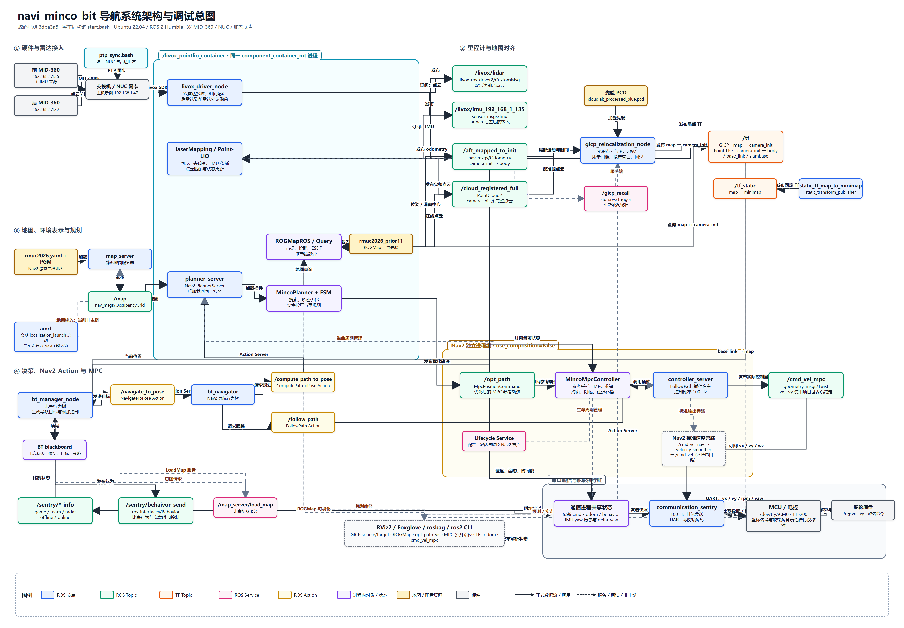

# navi_minco_bit 运行时架构与调试图



高清 PNG 可直接下载或放大查看；下方 Mermaid 保留全部细节关系，便于后续随源码同步修改。

> 核对基线：仓库提交 `6dba3a5`，日期 2026-10-02。图中只画当前 `start.bash` 启动链和源码中已确认的接口；被注释的独立裁剪节点、SLAM、rosbag 与 Foxglove 不进入正式控制主链。

## 图例

- 蓝色：ROS 节点或 ROS 组件节点
- 绿色：普通 ROS Topic
- 橙色：TF Topic
- 粉色：ROS Service
- 黄色：ROS Action
- 紫色：同一进程内的插件对象、共享状态或内存
- 棕色：地图与参数资源文件
- 灰色：硬件
- 青色外框：`component_container_mt` 组件容器进程
- 黄色外框：普通独立 ROS 进程组
- 实线：正式数据流、动作链或进程内调用
- 虚线：Service 调用、生命周期管理、调试输出或当前非主链关系

## 当前实车完整架构

```mermaid
flowchart TD
    classDef node fill:#e8f1ff,stroke:#2563eb,color:#111827
    classDef topic fill:#ecfdf5,stroke:#059669,color:#111827
    classDef tf fill:#fff7ed,stroke:#ea580c,color:#111827
    classDef service fill:#fdf2f8,stroke:#db2777,color:#111827
    classDef action fill:#fefce8,stroke:#ca8a04,color:#111827
    classDef memory fill:#f5f3ff,stroke:#7c3aed,color:#111827
    classDef resource fill:#fef3c7,stroke:#a16207,color:#111827
    classDef hardware fill:#f3f4f6,stroke:#4b5563,color:#111827
    classDef debug fill:#f9fafb,stroke:#6b7280,color:#111827,stroke-dasharray: 4 4
    classDef tool fill:#ecfeff,stroke:#0891b2,color:#111827

    subgraph HARDWARE["外部硬件"]
        FRONT["前 MID-360<br/>示例 IP：192.168.1.135<br/>主 IMU 来源"]:::hardware
        REAR["后 MID-360<br/>示例 IP：192.168.1.122"]:::hardware
        NET["交换机 / NUC 有线网卡<br/>示例主机 IP：192.168.1.47"]:::hardware
        MCU["MCU / 电控<br/>/dev/ttyACM0，115200 baud"]:::hardware
        SWERVE["舵轮底盘<br/>接收 vx、vy、旋转指令并执行"]:::hardware
    end

    PTP["scripts/ptp_sync.bash<br/>雷达与 NUC 时间同步"]:::tool

    subgraph LIVOX_CONTAINER["/livox_pointlio_container：同一 component_container_mt 进程"]
        DRIVER["/livox_driver_node<br/>livox_ros::DriverNode<br/>双雷达接收、配对与外参融合"]:::node
        POINTLIO["/laserMapping<br/>point_lio::LaserMappingNode<br/>IMU 传播、点云匹配、局部里程计"]:::node
        PLANNER["/planner_server<br/>nav2_planner::PlannerServer<br/>后加载到已有容器"]:::node

        MINCO["MincoPlanner 插件与 FSM<br/>createPlan 接收目标<br/>搜索、优化、重规划"]:::memory
        ROG["ROGMapROS / QueryInterface<br/>占据、投影、ESDF、先验融合<br/>MincoPlanner 进程内对象"]:::memory
    end

    subgraph SENSOR_TOPICS["传感器与 Point-LIO 输出 Topic"]
        LIDAR["/livox/lidar<br/>livox_ros_driver2/CustomMsg<br/>双雷达融合点云"]:::topic
        IMU["/livox/imu_192_168_1_135<br/>sensor_msgs/Imu<br/>launch 覆盖后的 Point-LIO 输入"]:::topic
        ODOM["/aft_mapped_to_init<br/>nav_msgs/Odometry<br/>frame=camera_init，child=body"]:::topic
        FULL["/cloud_registered_full<br/>sensor_msgs/PointCloud2<br/>camera_init 系完整去畸变点云"]:::topic
        CLOUD["/cloud_registered<br/>sensor_msgs/PointCloud2<br/>camera_init 系配准点云"]:::topic
    end

    subgraph TF_TOPICS["TF Topic"]
        TF["/tf<br/>map→camera_init：GICP<br/>camera_init→body/base_link/slambase：Point-LIO"]:::tf
        TF_STATIC["/tf_static<br/>map→minimap：static_transform_publisher"]:::tf
    end

    subgraph RELOCALIZATION["GICP 重定位独立进程"]
        GICP["/gicp_relocalization_node<br/>先验 PCD 配准、稳定性判定、超时回退"]:::node
        GICP_RECALL["/gicp_recall<br/>std_srvs/Trigger"]:::service
        GICP_PCD["cloudlab_processed_blue.pcd<br/>当前 target_pcd_file"]:::resource
    end

    subgraph NAV2_PROCESSES["Nav2 普通独立进程：use_composition=False"]
        MAP_SERVER["/map_server<br/>静态二维地图服务器"]:::node
        AMCL["/amcl<br/>localization_launch.py 会启动<br/>当前工程未发现有效 /scan 发布链"]:::node
        BT_NAV["/bt_navigator<br/>Nav2 导航行为树执行器"]:::node
        CONTROLLER["/controller_server<br/>FollowPath 插件宿主"]:::node
        MPC["minco_controller::MincoMpcController<br/>参考采样、MPC 求解、限幅"]:::memory
        SMOOTHER["/smoother_server"]:::node
        BEHAVIOR["/behavior_server"]:::node
        WAYPOINT["/waypoint_follower"]:::node
        VEL_SMOOTHER["/velocity_smoother<br/>参数 enabled=False"]:::node
        LM_NAV["/lifecycle_manager_navigation"]:::node
        LM_LOC["/lifecycle_manager_localization"]:::node
    end

    subgraph MAP_RESOURCES["地图资源"]
        NAV_MAP["rmuc2026.yaml + PGM<br/>Nav2 /map 来源"]:::resource
        ROG_PRIOR["rmuc2026_prior11.yaml + PGM<br/>ROGMap 二维先验障碍"]:::resource
    end

    subgraph NAV_INTERFACES["导航 Action、Service 与 Topic"]
        NAVIGATE["/navigate_to_pose<br/>nav2_msgs/action/NavigateToPose"]:::action
        COMPUTE["/compute_path_to_pose<br/>nav2_msgs/action/ComputePathToPose"]:::action
        FOLLOW["/follow_path<br/>nav2_msgs/action/FollowPath"]:::action
        MAP_LOAD["/map_server/load_map<br/>nav2_msgs/srv/LoadMap"]:::service
        LIFECYCLE["各生命周期节点的<br/>change_state / get_state Service"]:::service
        MAP_TOPIC["/map<br/>nav_msgs/OccupancyGrid"]:::topic
        OPT["/opt_path<br/>ros_interfaces/MpcPositionCommand<br/>MPC 主参考轨迹"]:::topic
        CMD_MPC["/cmd_vel_mpc<br/>geometry_msgs/Twist<br/>线速度采用项目世界系约定"]:::topic
        CMD_NAV["/cmd_vel_nav<br/>controller_server 标准输出旁路"]:::topic
        CMD_STD["/cmd_vel<br/>velocity_smoother 输出旁路"]:::topic
    end

    subgraph DECISION_PROCESS["比赛决策独立进程"]
        BT_MANAGER["/bt_manager_node<br/>两层比赛行为树与导航目标生成"]:::node
        BLACKBOARD["BehaviorTree blackboard<br/>比赛状态、当前位姿、目标与策略"]:::memory
    end

    subgraph COMM_PROCESS["串口通信独立进程"]
        COMM["/communication_sentry<br/>串口协议编解码与 100 Hz 控制发送"]:::node
        COMM_STATE["最新 cmd / odom / behavior<br/>底盘 IMU yaw 历史与 delta_yaw<br/>进程内共享状态"]:::memory
    end

    subgraph DECISION_TOPICS["比赛决策与通信 Topic"]
        STATUS["/sentry/game_info<br/>/sentry/team_info<br/>/sentry/radar_info<br/>/sentry/offline_info<br/>/sentry/online_info"]:::topic
        BEHAVIOR_CMD["/sentry/behaivor_send<br/>ros_interfaces/Behavior<br/>比赛行为与底盘附加控制"]:::topic
    end

    subgraph DEBUG_OUTPUTS["可视化与诊断输出"]
        GICP_DEBUG["/gicp_relocalization_node/debug/*<br/>source_raw/cropped/aligned、target_raw/cropped"]:::debug
        ROG_DEBUG["/rog_map/occupied、layer_value、field<br/>layer_height_delta、esdf 等"]:::debug
        PLAN_DEBUG["/opt_path_vis、/astar_path_vis<br/>/backup_path_vis、/recover_path<br/>/recover_goal、/minco_control_points_vis"]:::debug
        MPC_DEBUG["/mpc_predict_path<br/>/mpc_real_path"]:::debug
        AREA_DEBUG["/sentry/area_markers"]:::debug
        DEBUGGER["RViz2 / Foxglove / rosbag / ros2 CLI<br/>RViz2 默认启动；Foxglove 与 rosbag 默认注释"]:::debug
    end

    FRONT -->|"以太网点云、IMU、时钟数据"| NET
    REAR -->|"以太网点云、时钟数据"| NET
    PTP -->|"PTP 时间同步"| NET
    NET -->|"Livox SDK2 数据接收"| DRIVER

    DRIVER -->|"发布；容器内 ROS 接口"| LIDAR
    DRIVER -->|"发布；容器内 ROS 接口"| IMU
    LIDAR -->|"订阅：点云输入"| POINTLIO
    IMU -->|"订阅：IMU 输入；需覆盖点云末时刻"| POINTLIO

    POINTLIO -->|"发布局部里程计"| ODOM
    POINTLIO -->|"发布完整世界系点云"| FULL
    POINTLIO -->|"发布配准点云"| CLOUD
    POINTLIO -->|"发布动态坐标变换"| TF

    FULL -->|"订阅：累积配准源点云"| GICP
    ODOM -->|"订阅：局部运动与时间基准"| GICP
    GICP_PCD -->|"加载目标先验点云"| GICP
    GICP -->|"发布 map→camera_init；成功或超时回退"| TF
    POINTLIO -.->|"客户端：请求重新配准"| GICP_RECALL
    GICP_RECALL -.->|"服务端：重置并重启 GICP FSM"| GICP

    NAV_MAP -->|"加载"| MAP_SERVER
    MAP_SERVER -->|"发布静态地图"| MAP_TOPIC
    MAP_TOPIC -->|"Nav2 全局代价地图输入"| PLANNER
    MAP_TOPIC -->|"定位地图输入"| AMCL
    AMCL -.->|"缺少有效 /scan 时不属于当前定位主链"| TF

    PLANNER -->|"加载并调用插件"| MINCO
    MINCO -->|"构造并查询"| ROG
    FULL -->|"订阅：在线点云更新"| ROG
    ODOM -->|"订阅：滑窗中心与机器人状态"| ROG
    TF -->|"查询 map↔camera_init 以融合先验"| ROG
    ROG_PRIOR -->|"加载二维先验障碍"| ROG

    BT_MANAGER -->|"读写策略状态"| BLACKBOARD
    STATUS -->|"裁判与比赛状态"| BT_MANAGER
    ODOM -->|"当前局部位姿；结合 TF 转到 map"| BT_MANAGER
    TF -->|"查询 base_link→map"| BT_MANAGER
    BT_MANAGER -->|"发送比赛导航目标"| NAVIGATE
    NAVIGATE -->|"Action Server"| BT_NAV
    BT_NAV -->|"请求全局规划"| COMPUTE
    COMPUTE -->|"Action Server"| PLANNER
    MINCO -->|"异步发布优化轨迹"| OPT
    BT_NAV -->|"请求跟踪路径"| FOLLOW
    FOLLOW -->|"Action Server"| CONTROLLER

    CONTROLLER -->|"调用 FollowPath 插件"| MPC
    OPT -->|"订阅：优先参考轨迹"| MPC
    ODOM -->|"订阅：当前状态"| MPC
    MPC -->|"发布实际底盘主控制量"| CMD_MPC
    MPC -.->|"返回 Nav2 标准 TwistStamped"| CONTROLLER
    CONTROLLER -.->|"标准 Nav2 输出旁路"| CMD_NAV
    CMD_NAV -.->|"输入"| VEL_SMOOTHER
    VEL_SMOOTHER -.->|"输出；当前不接底盘主链"| CMD_STD
    CMD_STD -.->|"行为树特殊控制状态读取"| BT_MANAGER

    BT_MANAGER -->|"发布行为状态"| BEHAVIOR_CMD
    CMD_MPC -->|"订阅：vx、vy、wz"| COMM
    ODOM -->|"订阅：实际速度、姿态、时间戳"| COMM
    BEHAVIOR_CMD -->|"订阅：姿态、陀螺、隧道等策略"| COMM
    COMM -->|"更新发送快照"| COMM_STATE
    MCU -->|"UART 接收：比赛数据与底盘 IMU yaw"| COMM
    COMM -->|"发布解析后的比赛状态"| STATUS
    COMM -->|"UART 发送：vx、vy、rpm、yaw、delta_yaw 与行为数据"| MCU
    MCU -->|"舵轮解算与电机控制"| SWERVE
    SWERVE -->|"编码器与底盘状态反馈"| MCU

    BT_MANAGER -.->|"客户端：比赛切图"| MAP_LOAD
    MAP_LOAD -.->|"服务端：加载新地图"| MAP_SERVER
    LM_NAV -.->|"配置、激活、监控导航节点"| LIFECYCLE
    LM_LOC -.->|"配置、激活 map_server 与 amcl"| LIFECYCLE
    LIFECYCLE -.-> PLANNER
    LIFECYCLE -.-> CONTROLLER
    LIFECYCLE -.-> SMOOTHER
    LIFECYCLE -.-> BEHAVIOR
    LIFECYCLE -.-> BT_NAV
    LIFECYCLE -.-> WAYPOINT
    LIFECYCLE -.-> VEL_SMOOTHER
    LIFECYCLE -.-> MAP_SERVER
    LIFECYCLE -.-> AMCL

    GICP -.->|"visualization_en=true"| GICP_DEBUG
    ROG -.->|"按订阅者需求发布"| ROG_DEBUG
    MINCO -.->|"路径、恢复与控制点可视化"| PLAN_DEBUG
    MPC -.->|"预测与实走路径"| MPC_DEBUG
    BT_MANAGER -.->|"场地区域标记"| AREA_DEBUG
    GICP_DEBUG -.-> DEBUGGER
    ROG_DEBUG -.-> DEBUGGER
    PLAN_DEBUG -.-> DEBUGGER
    MPC_DEBUG -.-> DEBUGGER
    AREA_DEBUG -.-> DEBUGGER
    TF -.-> DEBUGGER
    TF_STATIC -.-> DEBUGGER
    ODOM -.-> DEBUGGER
    FULL -.-> DEBUGGER
    OPT -.-> DEBUGGER
    CMD_MPC -.-> DEBUGGER
    STATUS -.-> DEBUGGER

    style LIVOX_CONTAINER fill:#ecfeff,stroke:#0891b2,stroke-width:3px
    style NAV2_PROCESSES fill:#fefce8,stroke:#ca8a04,stroke-width:2px
    style RELOCALIZATION fill:#ffffff,stroke:#64748b,stroke-width:2px
    style DECISION_PROCESS fill:#ffffff,stroke:#64748b,stroke-width:2px
    style COMM_PROCESS fill:#ffffff,stroke:#64748b,stroke-width:2px
```



## 读图时必须注意的项目事实

1. `/livox_driver_node`、`/laserMapping` 与 `/planner_server` 位于同一个 `/livox_pointlio_container` 进程。驱动和 Point-LIO 开启了 `use_intra_process_comms=true`；`planner_server` 明确设置为 `false`，所以不能把 Point-LIO 到规划器的点云链直接当作零拷贝共享内存。
2. ROGMap 没有独立 ROS 节点。它由 `MincoPlanner` 在 `planner_server` 内构造，通过进程内对象向 MINCO 提供占据、投影和距离查询。
3. 当前全局坐标连接由 GICP 发布 `map→camera_init`。Point-LIO 发布 `camera_init→body/base_link/slambase`。看到 TF 存在，只能证明变换被发布，不能证明 GICP 本次配准成功，因为超时回退也会发布变换。
4. `/opt_path` 是项目自定义的 MPC 轨迹，不是普通 `nav_msgs/Path`。`/opt_path_vis` 才是用于 RViz 或 Foxglove 显示的路径。
5. 实车底盘主链为 `/cmd_vel_mpc → /communication_sentry → UART → MCU → 舵轮底盘`。`/cmd_vel_nav → /velocity_smoother → /cmd_vel` 是 Nav2 标准旁路，当前没有直接接入串口底盘主链。
6. `/cmd_vel_mpc.linear.x/y` 按项目的世界系约定生成。通信节点直接保存并封装这两个值，没有在回调中把它们旋转成车体系；MCU 端必须按协议约定结合 `current_yaw` 与 `delta_yaw` 处理方向。
7. `navigation2.launch.py` 包含官方 `localization_launch.py`，因此会启动 AMCL；但仓库当前没有找到可用的 `/scan` 发布链或 AMCL 专用参数。当前实际 `map→camera_init` 定位主链是 GICP，应在 NUC 运行时再次用节点图和日志核实 AMCL 状态。
8. `start.bash` 中 Foxglove 与 rosbag 默认被注释。RViz2 随 `navigation2.launch.py` 启动；启用额外观察工具时要记录其 CPU、网络和序列化负载。

## 故障定位入口

| 现象 | 第一检查点 | 继续向下追踪 |
|---|---|---|
| Point-LIO 不更新 | `/livox/lidar`、`/livox/imu_192_168_1_135` 的类型、频率、header stamp | IMU 是否覆盖点云末时刻、队列是否积压、参数是否被 launch 覆盖 |
| 局部里程计正常但地图错位 | GICP 的 source/target 调试点云与质量门槛 | `map→camera_init` 是成功结果还是超时回退，TF 时间基准是否一致 |
| 地图里没有实时障碍 | `/cloud_registered_full`、`/aft_mapped_to_init` | ROGMap 回调、`camera_init↔map` TF、滑窗和投影层 |
| 有目标但没有轨迹 | `/navigate_to_pose`、`/compute_path_to_pose` Action 状态 | planner 生命周期、Minco FSM、ROGMap 查询、`/opt_path` |
| 有 `/opt_path` 但无速度 | controller 生命周期与 `/follow_path` | MPC 是否收到 odom、轨迹 frame、求解与限幅日志、`/cmd_vel_mpc` |
| `/cmd_vel_mpc` 正常但底盘不动 | `/communication_sentry` 是否订阅、串口是否打开 | `delta_yaw_initialized`、UART 收发、协议单位和 MCU 舵轮方向约定 |
| 速度方向错误 | `/cmd_vel_mpc` 的 x/y 与 odom yaw | 通信封包、`current_yaw`/`delta_yaw`、MCU 世界系到车体系旋转与正方向 |

## 运行时核对命令

```bash
ros2 component list /livox_pointlio_container
ros2 node list
ros2 topic info -v /livox/lidar
ros2 topic info -v /livox/imu_192_168_1_135
ros2 topic hz /aft_mapped_to_init
ros2 topic hz /cloud_registered_full
ros2 topic echo /tf --once
ros2 action list -t
ros2 lifecycle nodes
ros2 topic hz /opt_path
ros2 topic echo /cmd_vel_mpc --once
ros2 topic info -v /cmd_vel_mpc
```

这张图是静态源码核查结果。首次在 NUC 启动后，应把上述命令输出与图逐项对照；若运行时名称或连接不同，以实际 ROS Graph 为准，并把差异回写到本文件。
